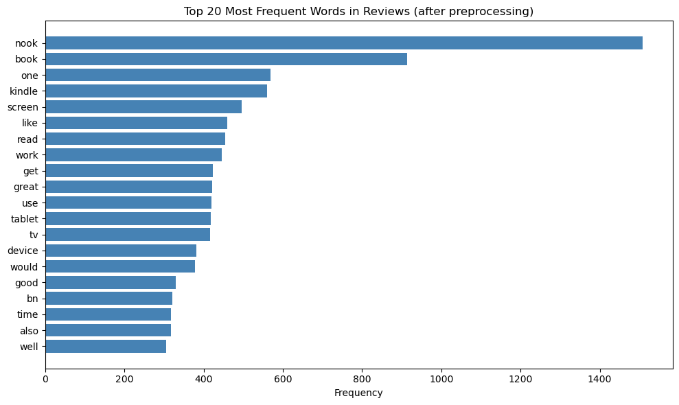
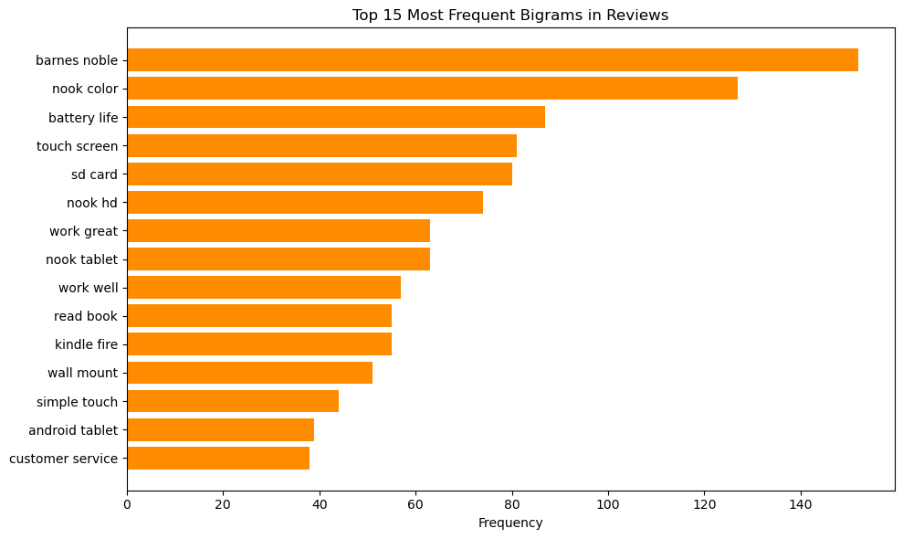
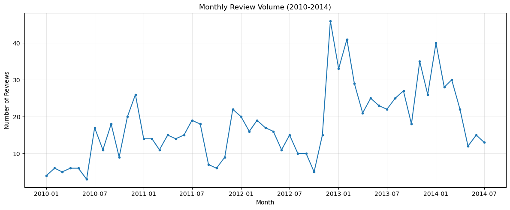
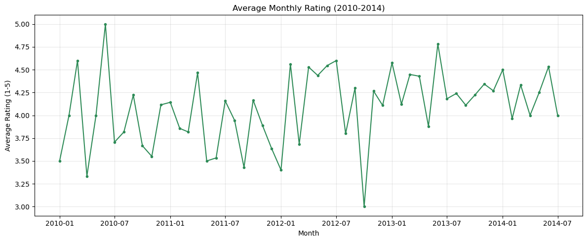
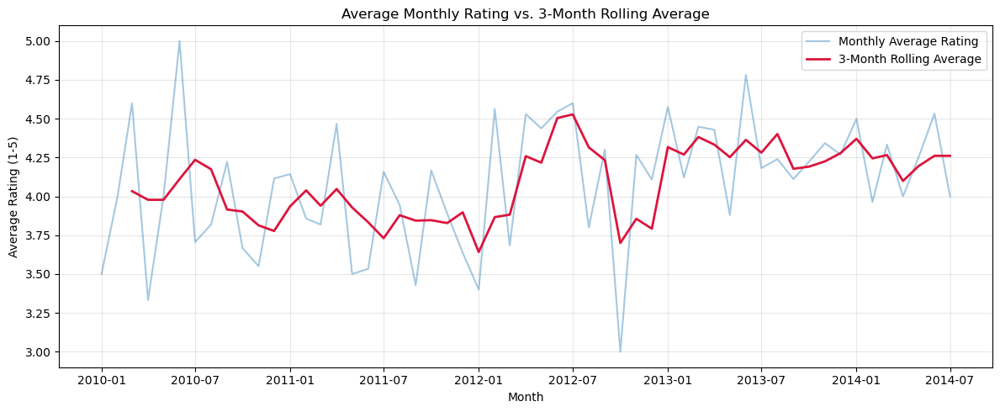
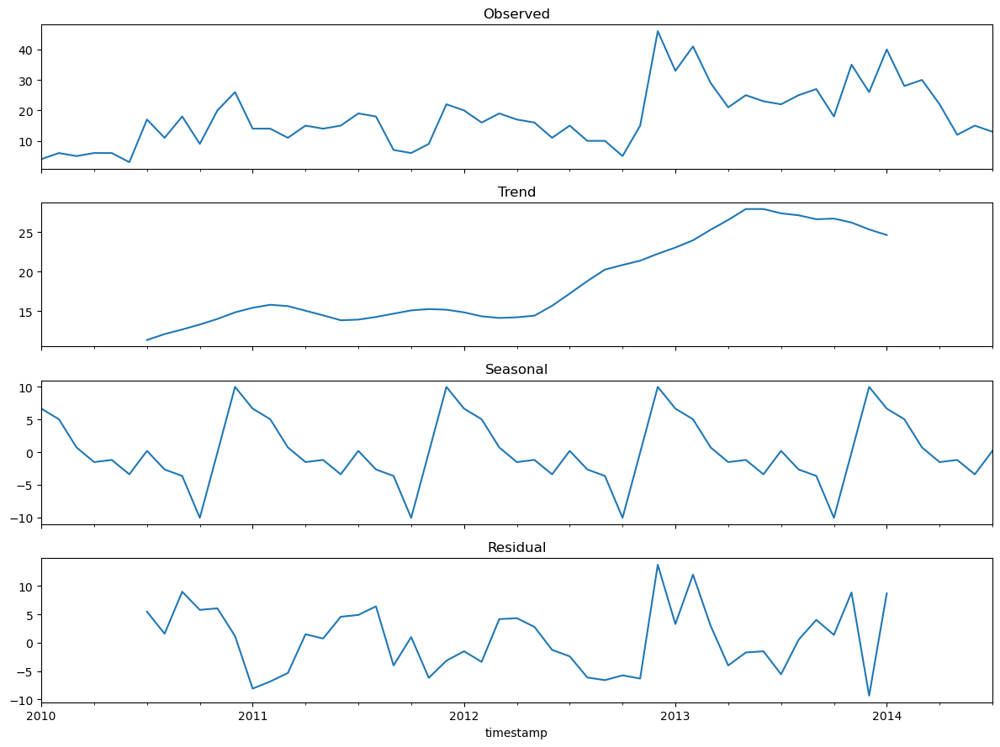
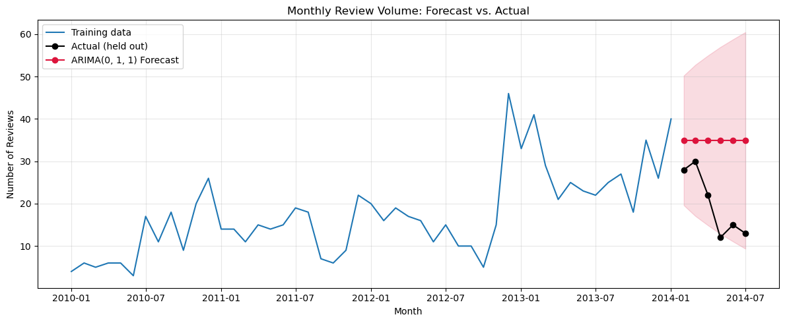
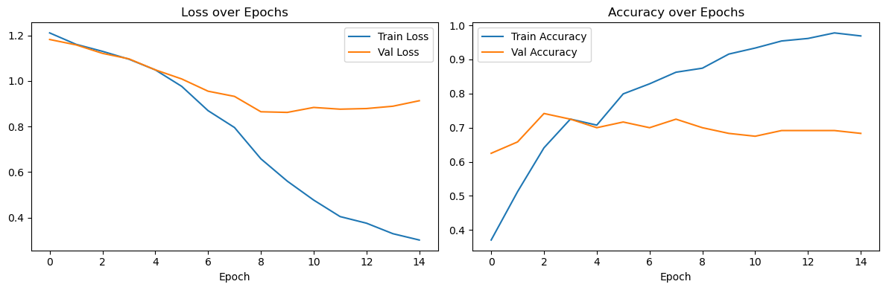
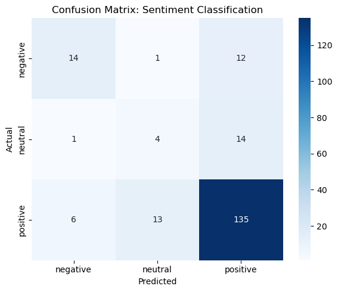

# Customer Reviews Analysis: NLP, Time Series and Neural Networks

What are customers talking about, how does review activity change over time, and can a neural network read a review and tell us how the customer felt? This project answers those three questions on a set of 997 Amazon product reviews, using text mining, ARIMA forecasting and a TF-IDF neural network classifier, and reports plainly where each method works and where it falls short.

**Short answer:** the language in the reviews is rich and easy to mine, monthly review volume follows a clear trend with a December spike, and the neural network separates happy from unhappy customers reasonably well. It cannot reliably identify neutral reviews, and its 76.5% test accuracy is no better than always guessing "positive" (77%). The value of this project is in the method, the diagnostics and the honest reading of the results.

## Problem Statement

An analytics firm wants to help clients make sense of large volumes of customer reviews, for example to route unhappy customers to the right support team, plan staffing around busy periods and spot recurring hardware complaints. This project asks:

1. **NLP:** which words and phrases do customers use most, and do they differ between positive, neutral and negative reviews?
2. **Time series:** how does monthly review volume and average rating change over time, and can volume be forecast?
3. **Neural networks:** can a model trained on review text predict the sentiment label (negative, neutral or positive)?

## Dataset

- **File:** `amazon_reviews_lab.csv`, provided with the lab
- **Size:** 997 reviews, 9 columns
- **Columns:** `product_id`, `rating`, `review_text`, `review_summary`, `review_time_raw`, `unix_review_time`, `timestamp`, `sentiment_label`, `review_length_words`
- **Date range:** May 2000 to July 2014, with 980 of the 997 reviews written between 2010 and 2014

Three properties of the data shape the whole analysis:

- **Ratings are heavily skewed to the positive side.** There are 580 five-star and 188 four-star reviews, against 87 one-star and 48 two-star reviews.
- **`sentiment_label` is a direct recoding of `rating`.** Ratings 1 to 2 are `negative` (135), 3 is `neutral` (94) and 4 to 5 are `positive` (768). It is a coarser version of the same signal, not an independent label.
- **Most reviews are from 2010 to 2014.** Only 17 reviews fall between 2000 and 2009, which is far too sparse to model as a time series.

## Approach

### Part 1: Natural language processing
1. Clean the review text: lowercase, strip URLs and punctuation, tokenise, keep alphabetic tokens, remove stopwords and lemmatise with NLTK.
2. Validate the cleaning by comparing a raw review with its tokens and measuring how much text and vocabulary the pipeline removes.
3. Count the most frequent words and bigrams, and plot them.
4. Compare the top words across the three sentiment labels.

### Part 2: Time series forecasting
1. Convert timestamps to datetimes and restrict the analysis to the well-sampled window, January 2010 to July 2014 (55 continuous months, none empty).
2. Resample to monthly review counts and monthly average rating, with a 3-month rolling average.
3. Test stationarity with the Augmented Dickey-Fuller test and difference the series.
4. Decompose the series into trend, seasonal and residual components.
5. Compare eight ARIMA orders on a 6-month hold-out window using AIC, BIC, MAE and RMSE.

### Part 3: Neural networks
1. Encode the three sentiment classes and vectorise the text with TF-IDF (2,000 features, English stopwords removed, `min_df=2`).
2. Make a stratified 80/20 train-test split (797 train, 200 test).
3. Compute balanced class weights to counter the imbalance.
4. Train a 64 and 32 unit dense network with L2 regularisation, 50% dropout and early stopping.
5. Train an unregularised baseline network to show the overfitting problem with an actual run.
6. Evaluate with a classification report and confusion matrix.

## Key Results

### NLP: this is a dataset about e-readers and tablets

After preprocessing there are 72,140 tokens. Only about 49% of raw words survive cleaning, and lemmatisation shrinks the vocabulary by about 18% (from 10,494 to 8,587 unique terms).

| Top words | Count | Top bigrams | Count |
|---|---|---|---|
| nook | 1,509 | barnes noble | 152 |
| book | 913 | nook color | 127 |
| one | 569 | battery life | 87 |
| kindle | 561 | touch screen | 81 |
| screen | 496 | sd card | 80 |




- **Product and hardware language dominates.** Words like `nook`, `kindle`, `screen`, `tablet` and `device`, and phrases like `battery life`, `touch screen` and `sd card`, show customers are talking about specific product lines and hardware features. These are exactly the terms a support-routing system would key on.
- **Sentiment shows up as evaluative words, not product names.** `nook`, `book` and `kindle` appear at the top of all three sentiment groups. `great` is prominent only in positive reviews (368 mentions), while negative reviews lean on `bn`, `device` and `time`.
- **Top single words alone cannot separate sentiment.** This is part of the motivation for TF-IDF in Part 3.

### Time series: a rising trend with a December spike





- **Volume grows then stays high.** Monthly counts range from 3 to 46 (median 16, mean 17.8), climbing from a handful per month in early 2010 to a peak in late 2012 and staying elevated through 2013 and 2014.
- **Ratings stay stable.** The 3-month rolling average sits between roughly 3.8 and 4.4 with no strong drift, so satisfaction does not erode as volume grows.
- **The series is non-stationary, then stationary after differencing.** The ADF p-value is 0.7457 at the level and 0.000078 after first differencing, so `d=1` is appropriate.
- **There is a December effect.** The additive decomposition gives a December seasonal component of +10 reviews, consistent with holiday gift purchases of e-readers.



| Order | AIC | BIC | Test MAE | Test RMSE |
|---|---|---|---|---|
| **(0, 1, 1)** | **337.69** | **341.43** | **14.93** | **16.55** |
| (1, 1, 0) | 337.93 | 341.67 | 16.27 | 17.83 |
| (2, 1, 1) | 338.80 | 346.29 | 11.05 | 12.57 |
| (0, 1, 2) | 339.21 | 344.83 | 12.27 | 14.03 |
| (2, 1, 2) | 340.21 | 349.57 | 10.67 | 12.25 |

(Five of the eight candidates are shown. The full table is in the notebook.)

- **AIC and out-of-sample error disagree.** ARIMA(0,1,1) has the best AIC and BIC, but higher-order models such as (2,1,1) and (2,1,2) have lower test error. Model selection here was on AIC for parsimony, and the disagreement is reported rather than hidden by picking whichever model scored best on the test window.
- **The forecast under-reacts to the slowdown.** Actual counts in the held-out months fall from the low 30s to the low teens, while the model forecasts a flatter path. The final test MAE is 14.93 reviews per month.
- **The MA(1) coefficient is borderline.** Its p-value is 0.055, and residual diagnostics show clear skew, so intervals should be read with caution.



### Neural network: good at the extremes, weak on neutral

| Metric | Value |
|---|---|
| Test accuracy | 0.765 |
| Test loss | 0.784 |
| Macro F1 | 0.55 |
| Epochs before early stopping | 15 |

| Class | Precision | Recall | F1 | Test support |
|---|---|---|---|---|
| Negative | 0.67 | 0.52 | 0.58 | 27 |
| Neutral | 0.22 | 0.21 | 0.22 | 19 |
| Positive | 0.84 | 0.88 | 0.86 | 154 |




- **The unregularised baseline overfits badly.** A 128 and 64 unit network with no L2 or dropout reaches 100% training accuracy but only 73.3% validation accuracy.
- **Regularisation helps but does not remove the gap.** The final model still shows about 96.9% training against 68.3% validation accuracy, and early stopping restored the best-validation-loss weights.
- **Accuracy flatters this model.** Positive reviews make up 77% of the test set (154 of 200), so a model that always predicts "positive" would score 77%, slightly above the 76.5% achieved here. Per-class precision and recall give the real picture.
- **Negative reviews are moderately learnable.** The model finds just over half of them, and most misses are labelled positive.
- **Neutral reviews are the hardest class.** Only about 4 of 19 are identified. A 3-star review often reads like a mildly positive or mildly negative one, so word-level TF-IDF features struggle to separate them. Recall for this class shifts between training runs, but it is always the weakest.

## Conclusions

- Customers write about specific products and hardware features, and frequency analysis on cleaned, lemmatised text surfaces them clearly.
- Review volume has a clear trend and a December seasonal spike, but a simple ARIMA fit on four years of data captures the level of activity better than the recent decline.
- The neural network is usable for coarsely separating clearly happy from clearly unhappy customers. It is not reliable for flagging the neutral segment, and overall accuracy hides this.
- Overfitting was the main modelling challenge. With under 1,000 reviews and 2,000 input features, regularisation, early stopping and class weights were necessary rather than optional.

## Limitations and Next Steps

- **Small dataset.** Only 94 neutral reviews exist in total, so more labelled neutral data would likely help more than further architecture tuning.
- **Class imbalance was handled only with class weights.** Resampling and threshold tuning, evaluated with precision-recall curves, are natural next steps.
- **No explicit seasonality in the forecast.** A seasonal model such as SARIMA would encode the December spike directly, and a shorter re-fit window might track the recent slowdown better.
- **The ARIMA validation window is short.** Six held-out months is a thin basis for comparing models, and rolling-origin validation would be more reliable.
- **Bag-of-words features lose word order.** Pretrained embeddings or transformer models such as BERT could capture subtle tone better than TF-IDF.
- **The sentiment label comes straight from the rating.** The model is predicting a coarsened star rating rather than independently labelled sentiment.
- **Mixed product types.** Although e-readers and tablets dominate, the dataset also includes other products, so topic-level analysis by product could sharpen the findings.

## Tech Stack

Python, pandas, NumPy, matplotlib, seaborn, NLTK, scikit-learn, statsmodels, TensorFlow and Keras, Jupyter

## How to Run

```bash
git clone https://github.com/ElvisOmondi7/customer-reviews-analysis.git
cd customer-reviews-analysis
pip install -r requirements.txt
jupyter notebook C09_M08.ipynb
```

The first run downloads the NLTK data packages (`punkt`, `punkt_tab`, `stopwords`, `wordnet` and `omw-1.4`), so it needs an internet connection. Results from the neural network can vary slightly between runs.

## Repository Contents

```
.
├── C09_M08.ipynb            # Full analysis notebook (NLP, time series, neural network)
├── amazon_reviews_lab.csv   # Dataset (997 reviews)
├── images/                  # Charts used in this README
├── requirements.txt         # Python dependencies
└── README.md
```

## Author

**Elvis Omondi Okoth**, Data Science and Statistics, Nairobi, Kenya

[LinkedIn](https://www.linkedin.com/in/elvis-omondi-200a06264) | okothelvisomondi@gmail.com | [GitHub](https://github.com/ElvisOmondi7)

Completed as a summative lab in the Data Science program at Moringa School.
